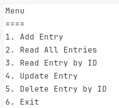

# Habit Logger

A console app for logging how many biscuits I eat.

## Requirements
* This is an application where you’ll log occurrences of a habit.
* This habit can't be tracked by time (ex. hours of sleep), only by quantity (ex. number of water glasses a day)
* Users need to be able to input the date of the occurrence of the habit
* The application should store and retrieve data from a real database
* When the application starts, it should create a sqlite database, if one isn’t present.
* It should also create a table in the database, where the habit will be logged.
* The users should be able to insert, delete, update and view their logged habit.
* You should handle all possible errors so that the application never crashes.]()

##  How it works

+ The Console app will connect to and SQLite database and cretae a table if one does not already exist.
+ A menu will display from which the user will enter 1-5 to create, read, uodate or delete an entry.
+ Entries are logged in the database in the format dd-MM-yy.
+ Entries in the future cannot be added but there is no limit to entires in the past.

## Challenges

Lots of them...
+ I had not used SQLite before so had to look that up and try out
+ I like to separate out as best I can logic, models and the UI
+ Code I have used from Stack overflow and a Tim Corey course I have not seen before.
  + Connecting to the database
  + Catching exceptions
  + Use of keyword checked - as explained...by default, if an integer calculation goes over its maximum possible limit in C#, it silently rolls over to a negative number (this is called an overflow). Wrapping a calculation in checked prevents this by forcing the application to throw an error instead of calculating the wrong number.
+ SQL commnds once I got one going for the Read I add and tweak the rest

##Improvements
I need to refactor with a better view to implementing DRY principles**

